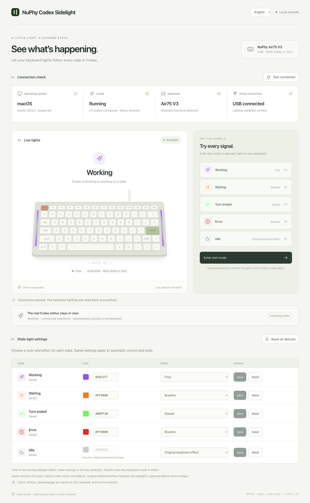

# NuPhy Codex Sidelight

**Give Codex a little glow.**

Give Codex a task. Switch windows. Let the two little light bars on your keyboard keep you in the loop.

Your NuPhy Air75 V3 already knows how to glow. Now it can tell you something, too.

[中文说明](README.zh-CN.md) · [MIT license](LICENSE)

🔵 Working on it. &nbsp; 🟠 Your turn. &nbsp; 🟢 Turn ended. &nbsp; 🔴 Something went wrong.



## Quick start

### Give Codex one more task: the setup

If you happen to have a **Mac, Codex, and a NuPhy Air75 V3 (ANSI)**, you have the ingredients. Connect the keyboard by **USB in wired mode**, paste this into a **local Codex chat**, and let Codex help set up its own status lights:

```text
Read this repository and help me install and configure NuPhy Codex Sidelight on this Mac:
https://github.com/joe960913/nuphy-codex-sidelight

I use Codex and a NuPhy Air75 V3 (ANSI). Check the requirements and clone
the project into a stable local directory. Install dependencies, build
and start the control panel, and configure the Codex hooks.
Preserve my existing hooks and settings.

Let me know when I need to connect USB, switch to wired mode, or personally
review and trust the hooks. Open the panel, verify the connection through
lighting readback, and test each state. Then restore automatic tracking
and help me verify it with a new local Codex turn.
Tell me what was verified and whether anything still needs my attention.
```

Stock firmware works. No flashing, extra account, or API key needed. The project runs locally, with a React panel for the fun bits: picking colors, trying effects, and watching the lights respond.

<details>
<summary>Prefer doing it yourself? Manual setup</summary>

You need Node.js **24+**, Python **3.11+**, and a USB data cable. Local Codex with [Hooks support](https://learn.chatgpt.com/docs/hooks) is required for automatic tracking; you can test the keyboard before enabling the hooks.

```sh
git clone https://github.com/joe960913/nuphy-codex-sidelight.git
cd nuphy-codex-sidelight

python3 -m venv .venv
.venv/bin/python -m pip install -r requirements.txt
npm ci
npm run build
npm start
```

1. Connect the keyboard and switch it to wired mode. Close NuPhy IO configuration windows to avoid competing device connections.
2. Open **[127.0.0.1:8765](http://127.0.0.1:8765)** and click **Test connection**. A detected receiver alone does not count as a verified keyboard connection.
3. Enter test mode and try the states. The UI confirms a lighting change only after reading the configuration back from the keyboard.

### Enable automatic Codex tracking

In another terminal, from the same project directory:

```sh
.venv/bin/python bridge.py install
```

This merges seven event handlers into `~/.codex/hooks.json`, preserves unrelated hooks, and backs up an existing configuration under `runtime/`. Start `codex`, enter `/hooks`, then review and trust this project's commands. They should run this checkout's `.venv/bin/python` with `bridge.py hook`. Start a new local Codex turn to verify that events arrive.

Hook configuration and received events are shown separately in the panel. Trust is always controlled by the user; the app does not change Codex trust records. Keep the checkout at the installed path. If you move it, uninstall from the old location first, then install and review the hooks again from the new one.

The first hook event starts the light controller automatically. Once installed, automatic tracking does not require the browser or web server to stay open. With the default idle profile, the controller restores the captured lighting and exits after about 30 idle seconds. A custom idle effect keeps it running.

</details>

## Your lights, your rules

Purple Flow while Codex works? Red Rhythm when something breaks? Pick a color and effect for each state, hit **Save**, and make it yours.

- **Five native effects to play with:** Breathe, Steady, Flow, Neon, and Rhythm. Or bring back the keyboard's original look.
- **Two little five-second nudges:** turn endings and errors each default to **5 seconds**, independently adjustable from **2–60 seconds**.
- **A test mode for the curious:** try every state on the actual keyboard, then return to following Codex.
- **English or 中文:** colors, effects, timing, and language all stay saved. Reset whenever you want a fresh start.

Here is what you get out of the box:

| State | Default lights | Meaning |
| --- | --- | --- |
| 🔵 Working | Blue · Breathe | “Working on it.” |
| 🟠 Waiting | Orange · Breathe | “A little help here?” — approval or a synchronous reply |
| 🟢 Turn ended | Green · Steady, 5 seconds | “Over to you.” — this turn has ended |
| 🔴 Error | Red · Breathe, 5 seconds | “That didn't go as planned.” |
| ⚪ Idle | Original keyboard effect | Back to your keyboard's usual look |

The green light means a turn ended. Reviewing the result is still your part of the collaboration.

<details>
<summary>The finer details: effects, timers, resets, and multiple chats</summary>

Each state supports **Breathe, Steady, Flow, Neon, Rhythm**, or **Original keyboard effect**. Neon cycles its own colors, so it does not use a fixed color. “Wave” is a main-key backlight effect; the sidebar's moving effect is **Flow**. Effects run on the keyboard; the app does not stream animation frames.

Use the color picker or a six-digit HEX value, choose an effect, and click **Save** for that state. Settings can be saved while the keyboard is disconnected. A saved preference and a hardware-confirmed lighting change are separate indicators. Changes to the active state apply when the device is available; other profiles apply when their state becomes active.

**Automatic notification duration** lets you set **Turn ended** and **Error** independently, from **2–60 whole seconds**, both defaulting to **5 seconds**. Save each duration separately; it persists across restarts. Timing starts at the lifecycle event and only affects automatic tracking. Test mode keeps the selected state until you switch it, exit, or its page lease expires.

**Reset** in a state row restores its default color, effect, and notification duration. Each duration also has its own reset, which keeps colors and effects. **Original keyboard effect** restores the sidelights captured before the controller took over, without factory-resetting the keyboard or changing its main-key backlight. Resetting all settings keeps your language preference. Existing preferences from earlier versions automatically use five-second durations while preserving saved colors and effects.

Multiple local chats are combined with this priority: **Error → Waiting → Working → Turn ended → Idle**. Test mode temporarily overrides this result. Closing the testing page releases its lease within 20 seconds and resumes automatic tracking. Asynchronous user questions are not treated as persistent waiting, because there is no matching reply hook to clear that state reliably.

</details>

## A small project, with a few practical notes

Currently verified on **macOS + NuPhy Air75 V3 ANSI + stock firmware + wired USB**. Both light bars act as one zone. Other NuPhy models, ISO layouts, wireless connections, Windows, and Linux are not supported by this release.

<details>
<summary>What stays on your Mac, and how to restore your lights</summary>

The server listens only on `127.0.0.1`. The app has no cloud backend and does not upload keyboard or chat data. It retains only lifecycle metadata: session/turn identifiers, timestamps, event/tool names, and local transcript paths/read positions. It reads lifecycle records from connected local Codex transcripts to recover task endings that arrive without a `Stop` hook; it does not retain chat text, tool arguments, or tool responses.

Generated files live in **`runtime/`**, which is excluded from Git:

- `preferences.json` — saved language, colors, effects, and durations. Keep it when migrating this checkout.
- `original-lighting.json` — recovery snapshot while the controller owns the lights. Keep it until restoration succeeds.
- Session state, hardware receipts, locks, and controller logs — local operational data.

An abrupt shutdown or unplugged keyboard may leave the last effect active. Reconnect by USB, remove the hooks, stop the web server, and wait for the controller to exit before manual recovery. If you configured a custom idle profile, reset Idle to **Original keyboard effect** first so the controller can exit.

```sh
# Remove only this checkout's hooks
.venv/bin/python bridge.py uninstall

# Restore the captured original sidelights once the controller has exited
.venv/bin/python nuphy.py restore
```

Do not delete the recovery snapshot before restoring. If settings are damaged, the UI reports the problem and lets you reset them instead of silently overwriting the file.

</details>

<details>
<summary>Want to tinker? Development and local tests</summary>

Keep `npm start` running for the local backend. In a second terminal, run `npm run dev` and open the Vite URL. Rebuild with `npm run build` to update the regular console.

```sh
npm test                             # Mocked protocol, lifecycle, settings, HTTP, and i18n tests
npm run build                        # Production React build
.venv/bin/python nuphy.py probe       # Read device details without changing lights
.venv/bin/python bridge.py status     # Inspect local lifecycle state
```

The tests run locally without a connected keyboard. They cover protocol rejection, lighting recovery, independent notification timers, concurrent test sessions, settings persistence, stale edits, local-only HTTP access, and hook installation. Hardware verification is separate: USB configuration readback and preserved main-key backlight were checked on an Air75 V3 ANSI, including all five native sidebar effects and restoration.

`src/` contains the React UI, `webapp.py` the loopback API, `bridge.py` the lifecycle controller, `preferences.py` shared settings validation, and `nuphy.py` the HID protocol.

</details>

<details>
<summary>Hardware notes and current limits</summary>

- The verified USB identity is `19f5:1028`. The tested `19f5:2620` wireless receiver rejects lighting queries; Bluetooth and receiver control are not implemented.
- Stock firmware exposes both sidebars as one zone. Independent left/right states and per-LED progress are not available.
- Lighting writes are rate-limited to at least two seconds apart. Long-term storage endurance under frequent configuration writes has not been measured.
- Only local Codex sessions emitting the supported lifecycle events are tracked. Cloud-orchestrated Work chats are outside this integration. This version uses the default `~/.codex` location.
- A session with no terminal event expires after 24 hours. A green light reports a turn ending, not task correctness or passing tests.
- The on-screen keyboard is an illustration; hardware readback confirms configuration, not a visual inspection of the physical LEDs.

</details>

## A little glow, thanks to a few good projects

- [OpenAI Hooks documentation](https://learn.chatgpt.com/docs/hooks) — lifecycle events and user-controlled trust.
- [kbvu protocol research](https://github.com/pda/kbvu/blob/main/docs/keyboard-protocol.md) and [N Agent Bridge protocol notes](https://github.com/bohu8264/N-Agent-Bridge/blob/main/docs/HID-PROTOCOL.md) — Air75 V3 protocol references.
- [cython-hidapi](https://github.com/trezor/cython-hidapi) — local HID communication.
- Native sidebar effect names and identifiers were cross-checked against NuPhy IO and verified by device readback.

Released under the [MIT license](LICENSE). An independent community project, not affiliated with NuPhy or OpenAI.
